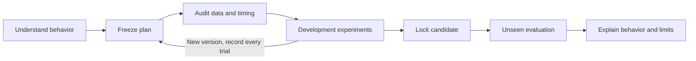
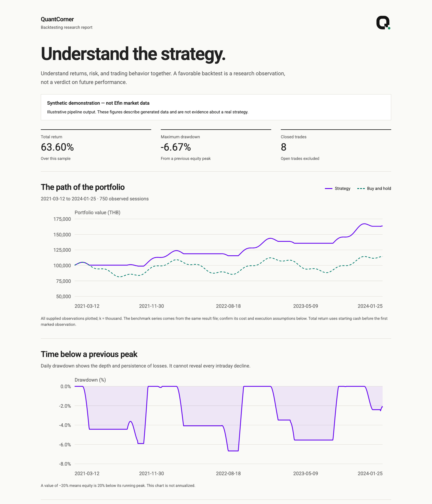

# QuantCornerBacktestingEfinMCP

A portable AI skill for **understanding long-only strategy behavior** with Efin MCP, a one-question-at-a-time grill-me interview, auditable research and offline QuantCorner visual reports.

## Install

```sh
git clone https://github.com/nutdnuy/QuantCornerBacktestingEfinMCP.git
cd QuantCornerBacktestingEfinMCP
python3 scripts/install.py --target codex
# or: python3 scripts/install.py --target claude
```

The display/repository name is **QuantCornerBacktestingEfinMCP**. The portable skill slug is `quantcorner-backtesting-efin-mcp` (lowercase skill naming convention).

Invoke `$quantcorner-backtesting-efin-mcp` and say: “Set up Efin, then interview me before researching my long-only strategy.” ภาษาไทย: “ตั้งค่าใช้งานครั้งแรก แล้วถามทีละข้อก่อนทำ Backtest เพื่อเข้าใจพฤติกรรมกลยุทธ์”

Python3.9+; no pip dependencies. Efin must already be connected in your AI host using your own licensed account. The installer never reads secrets or edits MCP configuration. Missing grill-me? The skill discloses and uses its bundled equivalent interview protocol; no extra dependency is needed. Read [onboarding](references/onboarding.md).

## คำสั่งและวิธีใช้

อ่าน [คู่มือคำสั่งพร้อมตัวอย่าง](references/commands.md) สำหรับคำสั่งคุยกับ Agent และ Terminal แต่ละคำสั่งทำอะไร รับไฟล์แบบไหน และได้ไฟล์อะไรกลับมา เริ่มง่าย ๆ ด้วย `$quantcorner-backtesting-efin-mcp ช่วยตั้งค่าครั้งแรก`

Version 0.2 adds chapter-14 trade statistics, realized cost reconciliation and drawdown/recovery durations. See [metric definitions and interpretation](references/metrics.md).

## Try without Efin

```sh
python3 scripts/demo.py --output /tmp/quantcorner-demo
python3 -m unittest discover -s tests -v
```

Open `report.html` in that output directory. The demo is **synthetic**, not an investment result. Reports are a single offline HTML with embedded fonts/logo, equity and drawdown, metric definitions and visible assumptions. Share the package freely; sharing licensed Efin data requires separate rights.

## Research workflow

Question → plan → data/engine audit → development experiments → locked held-out evaluation → behavior report. Preserve all experiments, including poor outcomes. Once a holdout influences revisions, it is development data and requires new evidence for confirmation.



The bundled reference engine supports a **single stock, daily, long-only** SMA crossover or supplied 0/1 targets, next-open execution, fees/slippage, board-lot rounding and same-asset buy/hold comparison. It is not a multi-stock factor portfolio engine, walk-forward optimizer, live broker or automatic corporate-action processor. No short selling, leverage or order placement.

Efin's observed price history does not declare its adjustment basis, and current index membership is not point-in-time membership. The skill explicitly gates these uncertainties; it does not turn missing metadata into invented evidence. See [Efin adapter](references/efin.md) and [framework](references/framework.md).

## Example report

The [standalone synthetic example](examples/report.html) can be downloaded and opened offline. The interview and narrative response follow the user’s language; fixed report labels in v0.1 are English, with Thai fonts embedded for user-provided titles and notes.



## Files and privacy

Keep research workspaces outside the repository. Plans, trial logs and provider data remain local. The public example report uses generated data only. Never commit MCP settings, API keys, cursor tokens, downloaded histories or reports containing licensed data. All paths are relative to the installation or caller-selected workspace.

Code/instructions: MIT. QuantCorner logo: separate limited brand permission in [ASSETS_LICENSE.md](ASSETS_LICENSE.md). Fonts: their bundled OFL licenses. Do not claim brand endorsement of a strategy. [Sources](references/sources.md) and [test evidence](TESTING.md).
