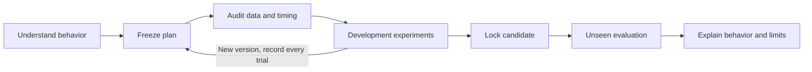

# QuantCornerBacktestingEfinMCP

A portable **suite of eight focused AI skills** for understanding long-only strategy behavior with Efin MCP. The original `quantcorner-backtesting-efin-mcp` entry point remains available and owns the shared engine, metrics, gates and branded report assets. Install once to get all **nine discoverable entry points**.

| Skill | Purpose |
|---|---|
| `ask-quantcorner` | Choose the next step from the request and existing evidence. |
| `qc-setup` | Prepare a private project and verify the existing Efin MCP connection. |
| `qc-design-strategy` | Interview with grill-me and record the agreed research plan. |
| `qc-audit-data` | Retrieve Efin data and audit coverage, timing, and price basis. |
| `qc-backtest` | Run and record an approved development experiment. |
| `qc-validate` | Orchestrate planned sensitivity trials and locked held-out evaluation. |
| `qc-explain-results` | Explain ratios, costs, drawdown recovery and strategy behavior. |
| `qc-report` | Render a standalone QuantCorner HTML report from an existing result. |

Start with:

```text
$ask-quantcorner I have Efin MCP connected and want to understand my long-only strategy.
```

Or invoke a focused skill directly, for example `$qc-report Generate a report from this result.json`. English skill names do not restrict the conversation language.

## Install

```sh
git clone https://github.com/nutdnuy/QuantCornerBacktestingEfinMCP.git
cd QuantCornerBacktestingEfinMCP
python3 scripts/install.py --target codex  # installs the complete suite
# or: python3 scripts/install.py --target claude
```

Reload skill discovery in your host after installation. For a previous copied installation, pull the updated repository and run `python3 scripts/install.py --target codex --upgrade` (or `--target claude`). Upgrades retain previous folders under `.quantcorner-backups/<id>/` in the selected skills directory; inspect backups for any local customizations. Unrecognized folders and symlinks are preserved/refused. Canonical symlink users update the canonical sources and links instead. `--destination /path/to/skills` supports other clients; load each installed SKILL.md using that client's supported mechanism.

The display/repository name is **QuantCornerBacktestingEfinMCP**. The portable skill slug is `quantcorner-backtesting-efin-mcp` (lowercase skill naming convention).

Invoke `$quantcorner-backtesting-efin-mcp Set up my workspace. Efin MCP is already connected.` The agent reuses your existing connection and asks only for missing setup or research details.

Python3.9+; no pip dependencies. Efin must already be connected in your AI host using your own licensed account. The installer never reads secrets or edits MCP configuration. Missing grill-me? The skill discloses and uses its bundled equivalent interview protocol; no extra dependency is needed. Read [onboarding](references/onboarding.md).

## Commands and usage

Read the [command reference with examples](references/commands.md) for agent requests and terminal commands, including each command's purpose, input format, and output files.

Start with `$quantcorner-backtesting-efin-mcp Show available commands`, or use `Define my strategy with grill-me`, `Audit Efin data for PTT`, `Run the approved backtest`, `Explain the performance metrics`, `Generate a QuantCorner report`, or `Run the synthetic demo`.

Version 0.3 adds focused skills, a single-install suite and persistent cross-skill handoffs. The version 0.2 helpers provide chapter-14 trade statistics, realized cost reconciliation and drawdown/recovery durations. See [metric definitions and interpretation](references/metrics.md).

## Try without Efin

```sh
python3 scripts/demo.py --output /tmp/quantcorner-demo
python3 -m unittest discover -s tests -v
```

Open `report.html` in that output directory. The demo is **synthetic**, not an investment result. Reports are a single offline HTML with embedded fonts/logo, equity and drawdown, metric definitions and visible assumptions. Share the package freely; sharing licensed Efin data requires separate rights.

## Research workflow

`ask-quantcorner` routes into setup → strategy design → data audit → development → validation → explanation → report, skipping stages whose evidence already exists. All stages share one private project and use its configured trial registry. CONTEXT.md retains decisions, plan.json defines the experiment, and handoff.json points to the next step and exact artifacts. See the [shared suite contract](references/suite.md).

Question → plan → data/engine audit → development experiments → locked held-out evaluation → behavior report. Preserve all experiments, including poor outcomes. Once a holdout influences revisions, it is development data and requires new evidence for confirmation.



The bundled reference engine supports a **single stock, daily, long-only** SMA crossover or supplied 0/1 targets, next-open execution, fees/slippage, board-lot rounding and same-asset buy/hold comparison. It is not a multi-stock factor portfolio engine, walk-forward optimizer, live broker or automatic corporate-action processor. No short selling, leverage or order placement.

Efin's observed price history does not declare its adjustment basis, and current index membership is not point-in-time membership. The skill explicitly gates these uncertainties; it does not turn missing metadata into invented evidence. See [Efin adapter](references/efin.md) and [framework](references/framework.md).

## Example report

The [standalone synthetic example](examples/report.html) can be downloaded and opened offline. The interview and narrative response follow the user’s language; fixed report labels are English, with Thai fonts embedded for user-provided titles and notes.


## Files and privacy

Keep research workspaces outside the repository. Plans, trial logs and provider data remain local. The public example report uses generated data only. Never commit MCP settings, API keys, cursor tokens, downloaded histories or reports containing licensed data. All paths are relative to the installation or caller-selected workspace.

Code/instructions: MIT. QuantCorner logo: separate limited brand permission in [ASSETS_LICENSE.md](ASSETS_LICENSE.md). Fonts: their bundled OFL licenses. Do not claim brand endorsement of a strategy. [Sources](references/sources.md) and [test evidence](TESTING.md).
